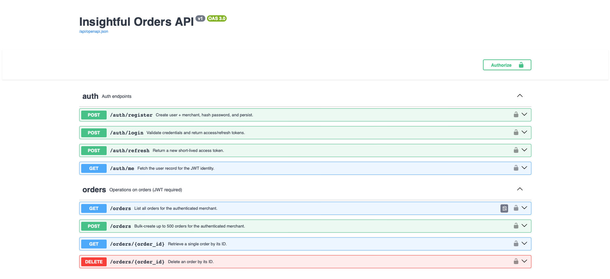
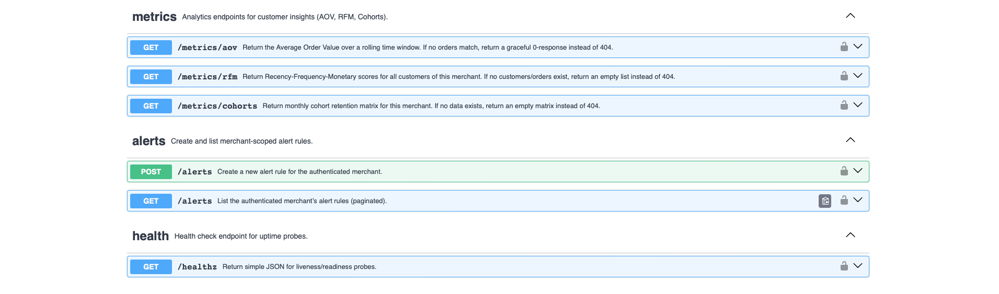
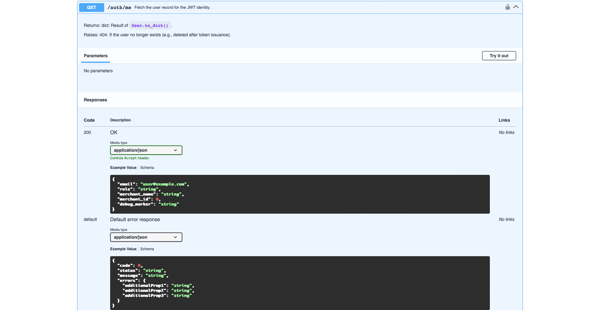
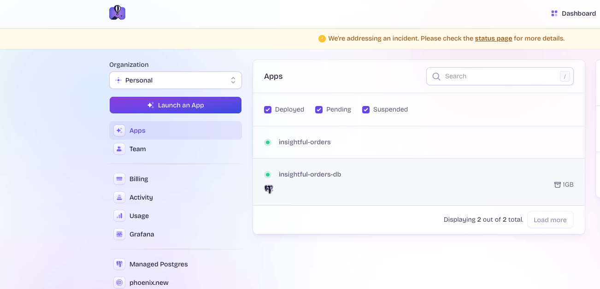
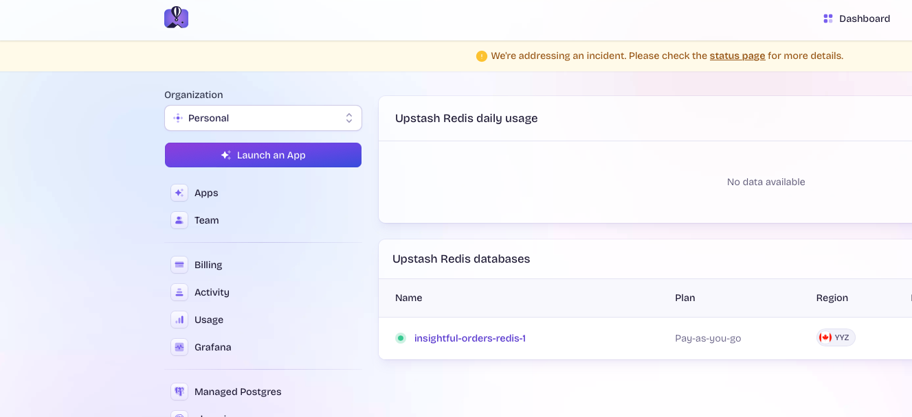
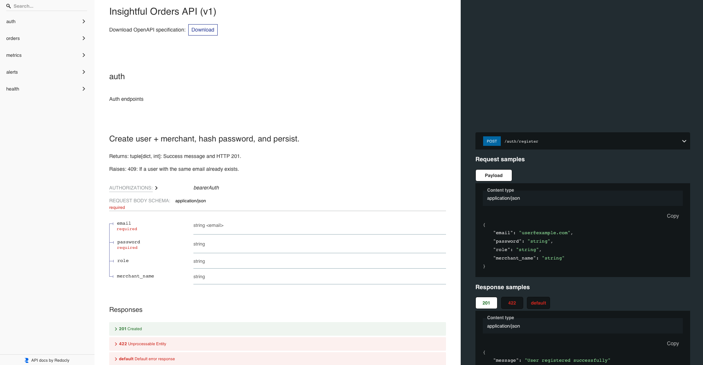

# Insightful-Orders — E-commerce Order-Intelligence API


Insightful-Orders is a containerised Flask microservice that ingests raw Olist order events, stores them in Postgres via SQLAlchemy ORM, calculates business-grade KPIs (rolling AOV, RFM scores, cohort retention), and emits real-time alerts over WebSockets. All endpoints are JWT-secured and documented with an auto-generated OpenAPI spec. The repo ships with a one-command dataset loader, >90% pytest coverage, GitHub Actions CI, and a prod-ready Docker Compose stack.

## Problem

Merchants collect lots of raw order events but lack **actionable insight**:
- What’s the **true AOV trend** over recent weeks?
- Which customers are **most valuable** (RFM) and who is **churning**?
- How do **cohorts retain** month over month?
- How do we **react in real time** when volume spikes or quality drops?

## Solution

**Insightful-Orders** ingests Olist orders into Postgres, computes **business-grade KPIs** (rolling AOV, RFM, monthly cohorts), and emits **real-time alerts** over WebSockets. The API is **JWT-secured**, fully **OpenAPI-documented**, ships with a **one-command dataset loader**, and runs identically in dev/CI via **Docker Compose** with >90% test coverage.

## ✨ Features

- **JWT-secured REST API** with auto docs at `/api/docs` (Swagger) and `/api/redoc`
- **Order analytics:** rolling AOV, RFM scores, monthly cohort retention
- **Real-time alerts** via **Redis pub/sub** → WebSocket
- **Postgres** (durable store) + **SQLAlchemy 2.x**
- **Alembic** migrations; pytest with **90%+ coverage**
- **Docker Compose** dev/prod stack; GitHub Actions CI-ready

## 🧩 Tech Stack

Flask 3 • Flask-Smorest • Marshmallow • SQLAlchemy 2 • Alembic • Postgres 15 • Redis 7 • flask-jwt-extended • Pytest/Factory Boy • Docker/Compose • GitHub Actions

## 📦 Repository Layout

```
insightful-orders/
├─ .github/workflows/                 # CI/CD pipelines
│  └─ ci.yml                          # Test + build + push Docker image
│
├─ app/                               # Flask application package
│  ├─ __init__.py                     # App factory + scheduler bootstrap
│  ├─ cli.py                          # Flask CLI entrypoint + commands
│  ├─ config.py                       # Dev/Test/Prod config classes
│  ├─ extensions.py                   # db, ma, jwt, migrate, redis_client
│  ├─ models.py                       # SQLAlchemy models
│  ├─ schemas.py                      # Marshmallow schemas
│  ├─ blueprints/                     # HTTP/WS route modules
│  │  ├─ auth.py                      # /auth register/login/refresh/me
│  │  ├─ health.py                    # /health check
│  │  ├─ metrics.py                   # /metrics aov | rfm | cohorts
│  │  ├─ orders.py                    # /orders list/bulk-create/get/delete
│  │  └─ alerts.py                    # /alerts create/list + /alerts/ws
│  ├─ services/                       # Domain/business logic
│  │  ├─ analytics.py                 # KPI computations (AOV, RFM, cohorts)
│  │  └─ alerts.py                    # Rule evaluation + Redis publish
│  ├─ utils/                          # Helpers/utilities
│  │  ├─ auth.py                      # JWT helpers (merchant_id extraction)
│  │  └─ helpers.py                   # paginate(), parse_*(), channel helpers
│  ├─ static/
│  │  └─ alerts.html                  # Minimal browser WS client (dev tool)
│  └─ tools/
│     └─ ws_listen.py                 # CLI WebSocket listener (dev tool)
│
├─ data/sample/                       # Olist demo dataset CSVs
│  ├─ olist_customers_dataset.csv
│  ├─ olist_orders_dataset.csv
│  ├─ olist_order_items_dataset.csv
│  ├─ olist_order_payments_dataset.csv
│  ├─ olist_order_reviews_dataset.csv
│  ├─ olist_products_dataset.csv
│  ├─ olist_sellers_dataset.csv
│  └─ product_category_name_translation.csv
│
├─ docker/                            # Container orchestration scripts
│  └─ entrypoint.sh
│
├─ docs/                              # Architecture + API docs + screenshots
│  ├─ architecture.md                 # Mermaid diagram
│  ├─ insightful-orders-docs-1.png    # Swagger screenshot 1
│  ├─ docs-2.png                      # Swagger screenshot 2
│  ├─ docs-3.png                      # Swagger screenshot 3
│  ├─ fly.io-1.png                    # Fly.io dashboard screenshot 1
│  ├─ fly.io-2.png                    # Fly.io dashboard screenshot 2
│  └─ redocs-1.png                    # ReDoc screenshot
│
├─ htmlcov/                           # Coverage reports (gitignored in CI)
│  └─ index.html
│
├─ instance/                          # Instance configs (ignored in git)
│
├─ migrations/                        # Alembic migrations
│  └─ versions/                       # Migration scripts
│
├─ scripts/                           # Data loading + utilities
│  ├─ downsample_olist.py
│  └─ seed_olist_subset.py
│
├─ tests/                             # Test suites (unit, routes, integrations)
│  ├─ integrations/                   # Integration tests (DB + app context)
│  │  ├─ test_alerts_ws.py
│  │  ├─ test_metrics_endpoints.py
│  │  ├─ test_orders_blueprint.py
│  │  ├─ test_orders_edges.py
│  │  └─ test_orders.py
│  ├─ routes/                         # Route smoke tests
│  │  ├─ test_docs.py
│  │  └─ test_metrics_rfm.py
│  └─ unit/                           # Pure unit tests (no DB/Redis)
│     ├─ factories.py
│     ├─ test_auth.py
│     ├─ test_alerts.py
│     ├─ test_analytics_aov.py
│     ├─ test_analytics_cohorts.py
│     ├─ test_analytics_edge.py
│     ├─ test_analytics_rfm.py
│     ├─ test_app_init.py (+ cov/edge/errorhandlers/scheduler variants)
│     ├─ test_cli.py (+ cov/seed_demo variants)
│     ├─ test_orders_validation.py
│     ├─ test_schemas_cov*.py
│     ├─ test_services_alerts.py
│     ├─ test_utils_auth.py
│     └─ test_utils_helpers.py
│
├─ .env / .env.prod                   # Environment configs (ignored in git)
├─ docker-compose.yml                 # Dev stack: api + db + redis
├─ docker-compose.prod.yml            # Production stack
├─ docker-compose.test.yml            # CI/test stack
├─ Dockerfile                         # API image (Python 3.11-slim)
├─ fly.toml                           # Fly.io deployment config
├─ Makefile                           # Dev/test helpers (make test, etc.)
├─ manage.py                          # Flask CLI entrypoint
├─ pytest.ini                         # Pytest config/markers/warnings
├─ requirements.txt                   # Python dependencies
├─ wsgi.py                            # WSGI entrypoint (prod servers)
└─ README.md                          # This file
```

## ✅ Prerequisites

- Docker & Docker Compose
- (For demo data) Kaggle API credentials:
  - Add `KAGGLE_USERNAME` and `KAGGLE_KEY` to `.env`
  - The script `scripts/downsample_olist.py` generates a 2,000-order sample
  - The script `scripts/seed_olist_subset.py` loads the subset into Postgres

## 🚀 Quick Start

### 1) Env & Data
```
cp .env.example .env   # set secrets + DB/Redis URLs (or rely on compose defaults)
python scripts/downsample_olist.py
```

### 2) Up The Stack
```
docker compose -f docker-compose.prod.yml up -d --build
```

### 3) Seed Demo Data
```
docker compose exec api python scripts/seed_olist_subset.py --merchant "Default Store"
```

### 4) Open API Docs

Swagger UI -> https://insightful-orders.fly.dev/api/docs

Redoc -> https://insightful-orders.fly.dev/api/redoc

## cURL Example Flow

### 🔐 Auth Flow (JWT)

**Register**
```curl -X POST https://insightful-orders.fly.dev/auth/register \
  -H "Content-Type: application/json" \
  -d '{
    "email": "olist_demo@example.com",
    "password": "your_password",
    "role": "admin",
    "merchant_name": "Default Store"
  }'
```

**Login -> Tokens**
```
curl -X POST https://insightful-orders.fly.dev/auth/login \
  -H "Content-Type: application/json" \
  -d '{"email": "olist_demo@example.com", "password": "your_password"}'
```

**Use the Token**
```
TOKEN="eyJhbGciOi..."   # copy from login response
```

**Verify Orders were Seeded**
```curl "https://insightful-orders.fly.dev/orders?page=1&page_size=5" \
  -H "Authorization: Bearer $TOKEN"
```

### 📊 Metrics Examples

**AOV (Rolling Window)**
```
curl "https://insightful-orders.fly.dev/metrics/aov?window=30d" \
  -H "Authorization: Bearer $TOKEN"
```

**RFM**
```
curl "https://insightful-orders.fly.dev/metrics/rfm" \
  -H "Authorization: Bearer $TOKEN"
```

**Cohorts**
```
curl "https://insightful-orders.fly.dev/metrics/cohorts?from=2017-01&to=2018-12" \
  -H "Authorization: Bearer $TOKEN"
```

### 🧾 Orders

**List (Paginated)**
```
curl -H "Authorization: Bearer $TOKEN" \
  "https://insightful-orders.fly.dev/orders?page=1&page_size=20"
```

**Bulk Create**
```
curl -X POST -H "Authorization: Bearer $TOKEN" -H "Content-Type: application/json" \
  -d '{
        "orders": [
          {
            "customer": {"email":"jane@example.com","first_name":"Jane","last_name":"Doe"},
            "status":"paid","currency":"BRL","total_amount":"120.50"
          },
          {
            "customer": {"email":"mike@example.com"},
            "total_amount":"75.00"
          }
        ]
      }' \
  https://insightful-orders.fly.dev/orders
```

### 🚨 Real-Time Alerts

**Create a Rule**
```
curl -X POST -H "Authorization: Bearer $TOKEN" -H "Content-Type: application/json" \
  -d '{"metric":"orders_per_min","operator":">","threshold":5,"time_window_s":60,"is_active":true}' \
  https://insightful-orders.fly.dev/alerts
```

**Subscribe (Browser UI)**

Open `static/alerts.html` in your browser, paste your JWT, and click **Connect**.

**Subscribe (CLI)**
```
# Inside container (or with local Python + websockets installed):
docker compose exec api python app/tools/ws_listen.py "$TOKEN"
```
Server will push JSON messages when rules are triggered.

## ⚙️ Configuration

| Key                       | Example                                    | Description                                                                         |
| ------------------------- | ------------------------------------------ | ------------------------------------------------------------------------------------|
| `SQLALCHEMY_DATABASE_URI` | `postgresql+psycopg2://...`                | App DB connection string                                                            |
| `DATABASE_URI`            | `postgresql+psycopg2://...`                | **Prod** DB URI (distinct from dev/test)                                            |
| `JWT_SECRET_KEY`          | `supersecret`                              | JWT signing key                                                                     |
| `REDIS_URL`               | `redis://redis:6379/0`                     | Redis connection                                                                    |
| `CONFIG`                  | `development` \| `testing` \| `production` | Chooses config class                                                                |
| `KAGGLE_USERNAME`         | `your_kaggle_username`                     | For Olist demo scripts (`downsample_olist.py`, `seed_olist_subset.py`)              |
| `KAGGLE_KEY`              | `your_kaggle_key`                          | For Olist demo scripts (`downsample_olist.py`, `seed_olist_subset.py`)              |

### 🧪 Testing
```
# Run all tests with coverage
make test

# Run tests against dev stack
make test-dev

# Run tests against prod stack
make test-prod

# Example result: 82 passed in ~15s
```

**SQL Verification (Fly Postgres)**
```
fly pg connect -a insightful-orders-db
\c insightful_orders

-- Verify merchant exists
SELECT id, name FROM merchants;

-- Verify seeded user exists
SELECT id, email, merchant_id FROM users WHERE email = 'olist_demo@example.com';

-- Verify orders seeded
SELECT COUNT(*) AS total_orders,
       COUNT(DISTINCT customer_id) AS unique_customers
FROM orders
WHERE merchant_id = (SELECT id FROM merchants WHERE name = 'Default Store');
```

## 📖 API Documentation

Insightful-Orders ships with auto-generated OpenAPI docs:

- **Swagger UI (interactive)** → [https://insightful-orders.fly.dev/api/docs](https://insightful-orders.fly.dev/api/docs)
- **ReDoc (reference)** → [https://insightful-orders.fly.dev/api/redoc](https://insightful-orders.fly.dev/api/redoc)








## 🛠️ Dev / Ops Notes

- Swagger: `/api/docs`, Redoc: `/api/redoc`, spec: `/api/openapi.json`
- OpenAPI is configured with a `bearerAuth` scheme—use **Authorize** in Swagger to test
- Healthchecks + named networks recommended in Compose (optional polish)

## License

Released under the [MIT License](LICENSE).

Data used for demos is downloaded from Kaggle’s Olist dataset under its original terms; the dataset is not redistributed in this repository.
